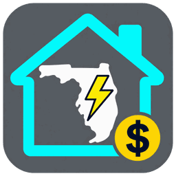
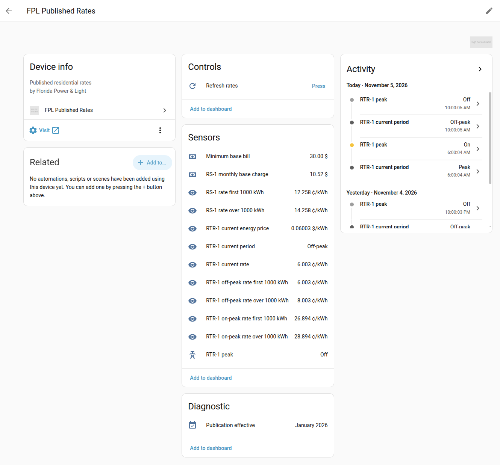

# FPL Published Rates

  
  
  
  

**Florida Power & Light electricity rates in Home Assistant.** See your
residential rate per kWh, know when the next off-peak window starts, and use
those signals in dashboards and automations. The integration reads FPL’s
public rate publications and requires no FPL account.

[Installation guide](docs/installation.md) · [Releases](https://github.com/emarrero-personal/ha-fpl-published-rates/releases) · [Report an issue](https://github.com/emarrero-personal/ha-fpl-published-rates/issues)

## Install

Requires Home Assistant **2026.3.0 or newer**. The button above opens
**Marketplace** on Home Assistant 2026.11 and newer, or **HACS** on earlier
versions with HACS installed. You can add the integration as a custom
repository today while its [catalog submission](https://github.com/hacs/default/pull/13540)
is in review.

1. Open the repository using the button above and confirm adding it if prompted.
2. Install **FPL Published Rates** and restart Home Assistant.
3. Go to **Settings → Devices & services → Add integration** and select
   **FPL Published Rates**.

If the button doesn’t open your instance, use the [Marketplace or HACS menu
instructions](docs/installation.md). You can also
[install manually](docs/installation.md#manual-installation).

## What you can do with it

| Use case | What Home Assistant shows |
| --- | --- |
| **See your standard residential rates (RS-1)** | Prices for the first 1,000 kWh and for usage above 1,000 kWh, plus the monthly base charge and minimum base bill. |
| **Schedule EV charging or other loads on the time-of-use plan (RTR-1)** | The current peak or off-peak period, the next scheduled change, and an **RTR-1 peak** binary sensor for automations. |
| **Put the time-of-use price on a dashboard** | Peak and off-peak rates for both usage tiers, plus the current first-tier rate in ¢/kWh and $/kWh. |
| **Estimate your RS-1 bill** | An optional bill estimate based on a monthly or billing-cycle energy sensor. |
| **Check the rate source** | The publication’s effective month and year, with a **Refresh rates** button. |

*Example device page. Rates shown are from the publication displayed in the screenshot.*

## Configure

- **Rate source.** By default, the integration looks for a residential PDF on the [FPL rates page](https://www.fpl.com/rates.html) and checks it every 24 hours. Check **Publication effective** after setup. To use a specific PDF, disable automatic discovery and enter its URL.
- **Peak schedule.** RTR-1 uses Eastern Time (`America/New_York`), including daylight saving time.
- **Bill estimate.** Select an energy sensor that tracks usage for your current month or billing cycle. The estimate covers RS-1 and excludes taxes, franchise fees, and account-specific charges.

## Documentation

- [Installation, configuration, and full entity list](docs/installation.md)
- [Rate calculations and peak schedule](docs/architecture.md)
- [Contributing and tests](docs/contributing.md)
- [Release guide](docs/releasing.md)

## Sources and credits

- **Rate data.** Florida Power & Light publishes the residential RS-1 and RTR-1 rates used by this integration. The test fixture uses synthetic values. [FPL published rates](https://www.fpl.com/rates.html)
- **Icon.** Original artwork created collaboratively by Ely Marrero and ChatGPT.
- **PDF parsing.** The integration uses pypdf, distributed separately under the BSD 3-Clause license. [pypdf license](https://github.com/py-pdf/pypdf/blob/6.21.4/LICENSE)

FPL Published Rates is an independent community project with no affiliation
with Florida Power & Light. Distributed under the [MIT license](LICENSE).
